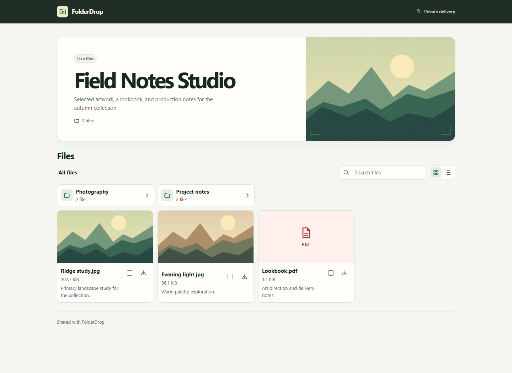

# FolderDrop

Send a curated delivery from your computer. Recipients open a private link with a one-time code, then browse, preview, download, or return files according to their access profile. FolderDrop runs without accounts, subscriptions, telemetry, or a model.



## Try it

FolderDrop requires Node.js 22.16 or newer. The proposed npm package name is `@kubilaycakmak/folderdrop`. After publication:

```sh
npx @kubilaycakmak/folderdrop@latest
npx @kubilaycakmak/folderdrop@latest "/path/to/delivery"
```

From a checkout:

```sh
npm ci
npm run dev
```

1. Browse a source folder, select files, and repeat for additional folders. Delivery paths are editable and independent of the original paths.
2. Add a title, introduction, cover, and file descriptions. Set the order and choose a theme.
3. Set an optional expiration and configure an inbox if you want to receive files.
4. Preview the delivery. Start a network listener and issue an access code for each recipient. Send the code separately from the link when possible.

The first successful redemption consumes the code and opens a browser session. The same code fails in any other browser or after the original browser loses its session. The sender can generate a fresh code or revoke a link. A local or LAN listener only works while the FolderDrop service is running.

## Commands

```sh
folderdrop --help
folderdrop --version
folderdrop menu
folderdrop diagnostics --json
folderdrop create ./files --title "Client delivery"
folderdrop list --json
folderdrop start DELIVERY_ID --mode lan
folderdrop issue DELIVERY_ID --label "Client reviewer"
folderdrop links DELIVERY_ID RECIPIENT_ID
folderdrop stop DELIVERY_ID
```

Use `npx @kubilaycakmak/folderdrop@latest <command>` if the executable is not installed globally. For release review, install the generated tarball with `npm install /path/to/kubilaycakmak-folderdrop-1.0.0.tgz` in a fresh directory and run `npx --no-install folderdrop`.

| Capability | Behavior |
| --- | --- |
| Administration | Loopback workspace with a launch key, guided setup, recipient preview, profiles, snapshots, listeners, progress, and revocation |
| Local and LAN | Loopback-only local sharing, or explicit interface binding with LAN addresses |
| Cloudflare | Explicit Quick Tunnel, verified optional provider acquisition, readiness, public-origin probe, reconnect, and teardown |
| Self-hosting | Recipient-only loopback upstream behind an HTTPS reverse proxy, with a configured external address and persistent state |
| Files and versions | Curated live manifests and independent, SHA-256-indexed snapshot copies with pinned links |
| Previews | Resized images, rasterized PDF pages, bounded UTF-8 text, and remuxed media when container and codecs permit |
| Downloads | Streaming originals and ZIPs, individual and selected files, bounded retry grants and byte ranges |
| Uploads | Opt-in inbox, resumable staged uploads, MIME and quota checks, cancellation, and collision-safe renaming |
| Agent tools | MCP over stdio using the official SDK, with explicit code creation and public start |

- [CLI and manifest reference](docs/cli.md)
- [Networking, Cloudflare, and self-hosting](docs/networking.md)
- [Lifecycle, snapshots, previews, and uploads](docs/lifecycle.md)
- [MCP setup and tools](docs/mcp.md)
- [Architecture and dependencies](docs/architecture.md)
- [Demo and screenshots](docs/demo.md)
- [Verification and platform results](docs/verification.md)
- [Contributing](CONTRIBUTING.md)
