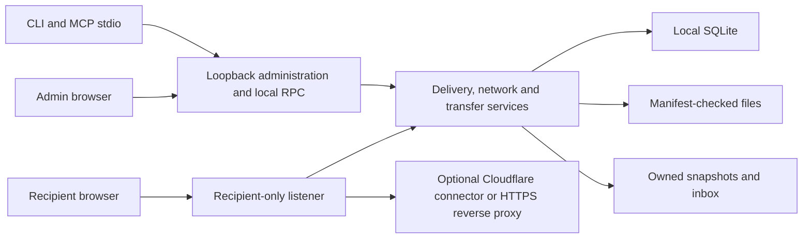

# Architecture

- `model.js` validates presentation, permission, lifetime, and virtual archive paths. `deliveries.js` applies transactional delivery and recipient policy plus optimistic manifest revisions.
- `store.js` persists records with SQLite WAL and synchronous commits. No database service is needed. One process owns the data directory while a service runs.
- `files.js` performs canonical path and descriptor authorization. `snapshots.js` copies and indexes independently owned files. `uploads.js` stages and commits uploads with offset and quota checks.
- `transfers.js` serves original and generated bytes with backpressure. Image decoding has input limits. PDF and media transformations run in short-lived, bounded workers.
- `network.js` owns listeners and restoration. `tunnel.js` owns the optional provider binary and subprocess. `admin.js` and `recipient.js` separate the HTTP surfaces.
- The CLI and MCP are local clients of the daemon. The browser uses local RPC behind an independent administrator session. All three use the same service methods.

## Security boundaries

The administrator trusts the local OS account, the operating system, installed software and the directories they select. Keep the data directory protected by the OS account's permissions, including Windows ACLs. A local account with access to the state directory can control the process and access the original files. The same user should own the application data and inbox. SQLite metadata, snapshots, and completed uploads are stored locally in plain form. Keep backups and storage outside any web root.

Only explicit regular paths are shared. FolderDrop rejects hidden names, Windows device names and streams, hard links, symlinks and junctions. Roots are anchored by filesystem identity. It verifies canonical paths, regular-file identity and link count before and after opening the same descriptor used for access. On Linux it additionally compares the opened descriptor path via `/proc/self/fd`. Portable Node APIs lack a single dir-handle-relative, kernel-enforced open for every OS. Use local filesystems that report stable file identifiers, and keep source and inbox folders out of write reach of untrusted local processes. Remote recipients never supply source paths or a host destination path.

Every recipient operation checks its delivery, profile, session and item permission. The HTTP surfaces validate Host; mutations require a custom request header and same-origin browser requests. Public and self-hosted requests always issue Secure recipient cookies. Both servers use a restrictive CSP. Active files are served as attachments with sandbox policy. Preview HTML comes from the application, with the original text escaped. PDF per-page rendering and transformed images are inert. The application stores neither third-party visitor tracking nor request access logs.

## Dependency choices

| Runtime package | License | Reason |
| --- | --- | --- |
| `@modelcontextprotocol/server` | Apache-2.0 | Official MCP stdio transport and tool schemas |
| `zod` | MIT | Input schemas for MCP |
| `sharp` | Apache-2.0 | Bounded image decoding, resizing, orientation and metadata stripping |
| `pdfjs-dist` | Apache-2.0 | PDF rasterization without browser plugin execution |
| `@napi-rs/canvas` | MIT | Native bounded-size PDF canvas |
| `mediabunny` | MPL-2.0 | Media container parsing and metadata-free remuxing without spawning an encoder |
| `yazl` | MIT | Streaming ZIP and ZIP64 |
| `file-type` | MIT | Signature detection for returned files |
| `mime-types` | MIT | Standard download content types |
| `age-encryption` | BSD-3-Clause | Streaming standards-based authenticated encryption for ZIP deliveries |
| `qrcode` | MIT | Browser and terminal QR output |

Production and development packages are pinned in the lockfile. Install production optional platform packages for Sharp and Canvas. The tarball does not include bundled third-party runtime source, browser binaries, provider binaries, or build tooling. Consult the installed packages for transitive notices and native-library licenses.
