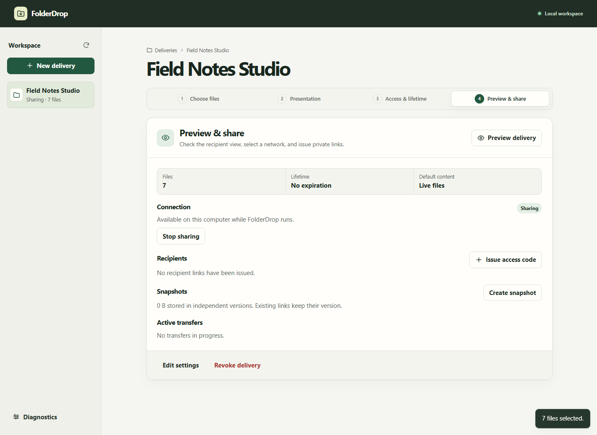
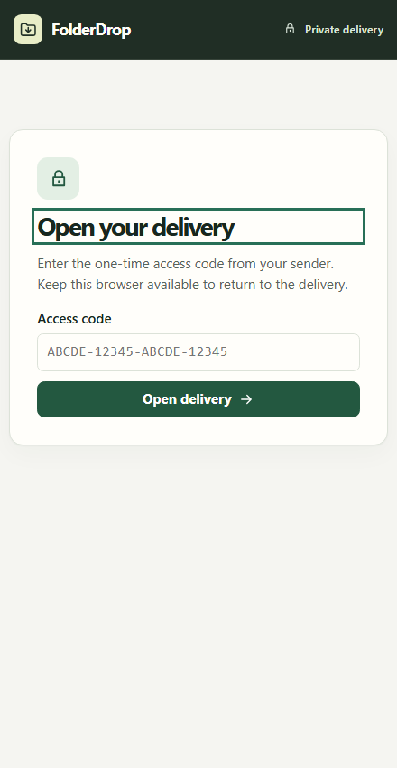
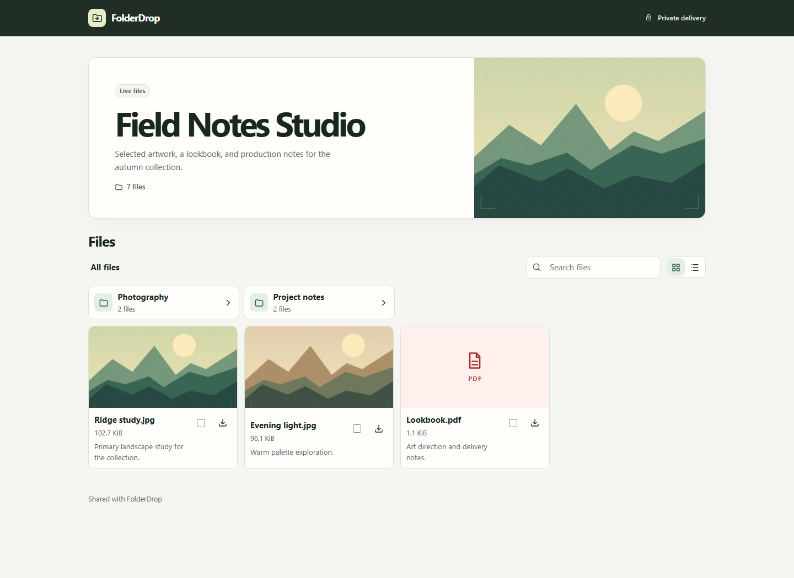

# Reproduce the demo

```sh
npm ci
npm run demo
npm run dev -- ".folderdrop-demo/Field Notes"
```

This generates deterministic original landscape study artwork, a two-page PDF, synthetic audio and video references, UTF-8 notes, and a file that exercises preview fallback. It makes a separate inbox and a curated `manifest.json`. Select a few files in the opened workspace, choose a theme and cover, configure the generated inbox folder, and start local sharing. Issue one access code and open the recipient URL in a separate browser profile. Try opening it with the same code in another clean profile.

To create the curated draft directly:

```sh
node bin/folderdrop.js create --input .folderdrop-demo/manifest.json --data-dir .folderdrop-demo/Data
node bin/folderdrop.js --data-dir .folderdrop-demo/Data
```

The tarball includes the demo generator and fixture source. Run `node /path/to/installed/folderdrop/demo/create.js /path/to/fixture-output` to generate the same files from an install.

## Working screenshots







The screenshots are captured from loopback browser journeys. Set `FOLDERDROP_SCREENSHOTS=1` and run `npm run test:browser` to regenerate them. Playwright mock data is only used as file fixture content. Browser interactions reach the real application.
